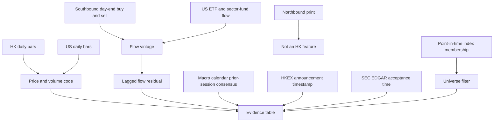

# Data

This page lists the data one run requires and where to get it. It is a plan. It is not a backtest. No series below has been scored.

Each print keeps its own currency (plan). The only conversion in the MVP is the liquidity floor, at 7.80 HKD per USD (plan). That rate is a frozen constant. It is not an FX trade.

## What is required

The run needs the following (plan):

- Daily bars for universe names, the touched sector ETFs, and the local index. The research window is 60 sessions (plan). Code writes the return, realized vol, and volume versus its 20-session median (plan). Dollar volume feeds the liquidity floor.
- Southbound day-end buy and sell, with a vintage. If southbound is stale, HKEX turnover concentration is the fallback (plan). The feature that enters the topic score is the lagged residual, not raw net buy (plan).
- US ETF flow and sector-fund flow, with a vintage. The same residual rule applies (plan).
- The macro calendar. Consensus is as of the prior session (plan). The actual enters only after it has printed (plan). The plan's set is CPI, payrolls, the Fed, PBoC and HKMA liquidity, and China PMI because it hits Hong Kong (plan).
- HKEX announcements with the release timestamp.
- SEC EDGAR filings with the acceptance timestamp.
- Point-in-time membership for Hang Seng, Hang Seng TECH, and S&P 500.

Northbound is not a Hong Kong feature (plan). A northbound print does not fill the Hong Kong flow row and does not fill the transmission slot.

The cross-market slot uses revenue share or southbound holding (plan). Each needs a frozen floor of 5% of the relevant total (plan). The denominator is frozen with the floor (plan). It is unknown here until that freeze. Rate beta cannot fill the slot (plan). Southbound holding is not the daily buy and sell series. Do not swap them.

Sign expiry is in [execution.md](execution.md). The vintages have to support it. Macro and news expire after 5 sessions (plan). Flow expires after 10 sessions (plan). A filing expires at the next print or at 20 sessions, whichever is sooner (plan).

Vintages also have to show that a print was public before the decision close in [execution.md](execution.md). A later close in the other market does not make the print known. The beta-window length stays unpublished. This page does not set it.

## Sources into the evidence table

The residual is lagged flow after the same-window return (plan). Raw net buy stops at the vintage. It does not enter the table as a score.

## Free public sources

Free means public pages. It does not mean a point-in-time tape.

- Daily bars. HKEX public quotations and Yahoo Finance daily bars are free convenience files. A file adjusted as of today is not point-in-time. Nasdaq and NYSE public quotes have the same limit.
- Southbound day-end buy and sell. HKEX Stock Connect pages on hkex.com.hk publish the daily print. On 12 April 2024 (checked, HKEX news release) HKEX said other southbound dissemination would remain in place, aside from the quota-balance display. The live page is not a store of later revisions.
- HKEX announcements. HKEXnews at hkexnews.hk is the primary release time.
- US filings. SEC EDGAR at sec.gov/edgar carries the acceptance datetime. Use that time. The period end is not a timestamp.
- Macro schedule and official actuals, after release. US CPI and payrolls are at the Bureau of Labor Statistics. US GDP is at the Bureau of Economic Analysis. The FOMC calendar is at the Federal Reserve. Hong Kong CPI is at the Census and Statistics Department. HKMA liquidity is at the HKMA. PBoC statements are at the PBoC. China PMI is at the National Bureau of Statistics.
- Current index pages. Hang Seng Indexes at hsi.com.hk and S&P Dow Jones at spglobal.com publish current methodology and current constituents. A current list is not history.

## Claims that need a paid point-in-time feed

These claims are not free just because a headline number is public.

- Point-in-time membership, with add and delete dates. Hang Seng, Hang Seng TECH, and S&P 500 each need a vendor change file. The class of feed is Hang Seng Indexes historical constituents, S&P Dow Jones constituent history, CRSP, Compustat, Refinitiv, Bloomberg, or FactSet. Wikipedia change lists are not that tape. CRSP is a US tape. It does not cover Hong Kong.
- Daily bars as they were known on the decision date, including delistings and the corporate-action vintage. The same paid class covers this. A self-archived snapshot can stand in only if it was stored before the decision.
- Flow as known before the decision, with later revisions kept out. Daily US ETF and sector-fund flow with a vintage is a paid tape in the EPFR, Bloomberg, or FactSet class. A free issuer page is not that tape. Whether a complete free revision archive of HKEX southbound exists is unknown. Until one is shown, store the print yourself or use a paid vintage.
- Consensus as of the prior session. Official release pages do not carry it. The class of feed is Bloomberg or Refinitiv. A free calendar that shows a live consensus can change. It is not the prior-session snapshot.

HKEXnews release times and EDGAR acceptance times are free primary timestamps. They do not need a paid feed if the page is the original filing. They still need to be read as the acceptance or release time, not the period end.

## Hang Seng TECH history

Hang Seng TECH launched on 27 July 2020 (checked, Hang Seng Indexes methodology). The vendor base date is 31 December 2014 (checked, the same methodology). An HKEX circular dated 5 November 2020 records that same launch date (checked). Rows before the launch are a back-cast. They are not live membership. The testing rule is in [testing.md](testing.md).

## Northbound disclosure

Northbound stays out of the Hong Kong feature set on both sides of the break (plan). The break still matters because a blended Stock Connect file can hide it.

Real-time northbound turnover and the real-time daily quota balance changed on 13 May 2024 (checked, HKEX circular dated 3 May 2024). The remaining items, including northbound shareholding detail moving to a quarterly search, were set for 19 August 2024 (checked, HKEX circular CD/DNS/CCASS/217/2024). A test splits any Stock Connect file at both dates. The rule is in [testing.md](testing.md).

## Costs

Hong Kong stamp duty on a stock transfer is 0.1% a side (checked, HKEX transaction fees and the Inland Revenue Department). That rate has applied from 17 November 2023 (checked, Inland Revenue Department). From 1 August 2021 through 16 November 2023 the rate was 0.13% a side (checked, Inland Revenue Department rate table). A test uses the rate in force on the fill date. It does not freeze 0.1% across earlier years. Earlier rates sit on the same Inland Revenue Department table.

The US explicit commission in this spec is unknown. Freeze a schedule before any traded-P&L test, or report that column gross of commission and say so. Do not invent a US fee.

## Evidence row

The plan's row carries date, market, source URL or ticker, figure, baseline, and surprise (plan). The run adds currency and a vintage timestamp so the checker can recompute (plan).

An empty row looks like this. The blanks are the target shape. They are not a sample.

- Date.
- Market.
- Source URL or ticker.
- Figure.
- Unit and currency.
- Baseline.
- Surprise.
- Vintage timestamp.

Surprise is code (plan). The language model does not subtract in prose (plan). A reason that does not contain a table figure fails closed (plan).

## Checked sources

- [Hang Seng TECH methodology PDF](https://www.hsi.com.hk/content/dam/wpb/hsil/index/methodologies/en_hk/hstech/IM_hstech.pdf). Launch date 27 July 2020 (checked). Base date 31 December 2014 (checked).
- [HKEX circular MKS/EQD/32/20](https://www.hkex.com.hk/-/media/HKEX-Market/Services/Circulars-and-Notices/Participant-and-Members-Circulars/HKFE/2020/MKS_EQD_32_20_e.pdf). Dated 5 November 2020 (checked). It records the 27 July 2020 launch (checked).
- [HKEX, SSE, and SZSE disclosure plan](https://www.hkex.com.hk/News/Market-Communications/2024/2404122news?sc_lang=en). Dated 12 April 2024 (checked).
- [HKEX circular on the May 2024 northbound change](https://www.hkex.com.hk/-/media/HKEX-Market/Services/Circulars-and-Notices/Participant-and-Members-Circulars/SEHK/2024/CT06124B.pdf). Dated 3 May 2024 (checked). Implementation date 13 May 2024 (checked).
- [HKEX circular CD/DNS/CCASS/217/2024](https://www.hkex.com.hk/-/media/HKEX-Market/Services/Circulars-and-Notices/Participant-and-Members-Circulars/HKSCC/2024/ce_HKSCC_NOM_217_2024.pdf). Remaining items set for 19 August 2024 (checked).
- [HKEX transaction fees](https://www.hkex.com.hk/Services/Rules-and-Forms-and-Fees/Fees/Securities-(Hong-Kong)/Trading/Transaction?sc_lang=en). Stamp duty is 0.1% a side (checked).
- [Inland Revenue Department notice of 15 November 2023](https://www.ird.gov.hk/eng/ppr/archives/23111501.htm). The 0.1% rate takes effect on 17 November 2023 (checked).
- [Inland Revenue Department rate table](https://www.ird.gov.hk/eng/pdf/sd_stock_rates.pdf). The rate was 0.13% a side from 1 August 2021 through 16 November 2023 (checked).
