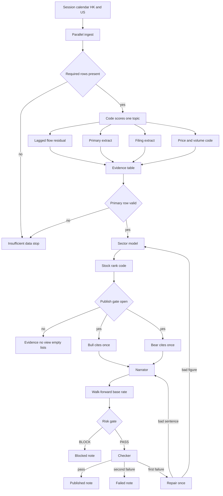

# Execution

This page is the run, step by step. It is a plan. It is not a backtest. No figure below is a measured return.

Code owns the topic, every figure, and every rank. A language model extracts primary documents into a schema and writes sentences that cite table figures. It does not emit a return, a rank, or a topic score.

## Scope

Markets are Hong Kong (HKEX, HKD) and the US (NYSE and Nasdaq, USD) (plan). There are no A-shares (plan). There is no FX overlay beyond the currency of each print and the liquidity conversion below (plan). The horizon is the next 1 to 4 weeks (plan). The universe is Hang Seng, Hang Seng TECH, and S&P 500 (plan). The plan sketches that set at about 600 names (plan). That sketch is not a live count.

One run publishes one note, or it stops. The note has a topic, evidence, a sector opportunity and risk, a short best list, a short worst list, and a quality-check verdict. The MVP places no orders (plan).

## The run

The repair edge returns to the sector model or the narrator. It does not return to topic choice. It does not skip the publish gate. A bad figure must face the gate again. A second checker failure publishes a failed note. Missing data, a risk-gate block, and a second failure end the run. No node places an order.

Tool retries sit inside a fetch. The cap is 3 (plan). They are not research iterations.

### 1. Session calendar

The calendar names the Hong Kong session and the US session (plan). A holiday in one market does not invent a bar. The next run marks the previous sign live, void, or expired before it opens a new topic (plan). A `no view` note does not open a sign (plan).

Sign expiry, once a sign exists (plan):

- Macro and news expire after 5 sessions (plan).
- Flow expires after 10 sessions (plan).
- A filing expires at the next print or at 20 sessions, whichever is sooner (plan).

### 2. Parallel ingest

Ingest uses four tool servers (plan). Each returns typed rows or a typed error. They do not judge the topic.

- Market data returns daily bars and dollar volume.
- Flow returns southbound buy and sell, or HKEX turnover concentration if southbound is stale, plus US ETF flow and sector-fund flow.
- Filings return HKEX announcements and SEC EDGAR filings on separate schemas.
- The macro calendar returns the schedule, the consensus as of the prior session, and the actual only after it has printed.

Web fetch is an allowlist of primary hosts (plan). The hosts are the exchange, the central bank, the regulator, company IR, and EDGAR. A recap domain is not a source. The model calls a stats tool for every baseline. It does not subtract in prose.

If the flow print the topic needs is missing, or the primary document is missing, or prices for the scored sector are missing, the run ends as insufficient data (plan). It does not publish a thinner thesis.

### 3. Topic score

Code scores four feeds and picks one study (plan). It does not blend them.

- Capital flow.
- News that moves an index or a GICS sector.
- The next scheduled macro print.
- Filings.

The score is a robust z-score of each feed versus its own 20-session baseline, times breadth (plan). Surprise is the gap versus that baseline (plan). Breadth is how many sectors the item touches (plan). The tie-break is macro, then filings, then flow, then news (plan). News alone is the weakest topic (plan).

News is eligible from the last 5 sessions (plan). A filing topic sits inside a 10-session window (plan). The macro tool may nominate a print only when the consensus gap or the recent sector move clears the same z-score bar as the other feeds (plan). Otherwise the print is not a topic.

Flow in the topic score is the lagged residual of flow on the same-window return (plan). Raw net buy does not enter the topic score (plan). Northbound is not a Hong Kong feature (plan). The Hong Kong flow feed is southbound, or HKEX turnover concentration when southbound is stale (plan). The fallback is residualized the same way (plan).

A language model may label a headline or a filing into a sector from a fixed list (plan). It may not choose the topic or edit the score. Embeddings may dedupe near-copy headlines (plan). They are not a score. High similarity between the thesis and secondary recaps is a reject, not support (plan).

### 4. Evidence workers

The workers run only for the chosen topic (plan). They write rows. They do not write the score.

- Primary extract searches for the exchange notice, the central-bank text, or the company filing. It fills the evidence schema. It does not summarize the web.
- Filing extract reads filings only for names already on the sector shortlist (plan). Hong Kong reports and US filings stay on separate schemas (plan).
- Price and volume are code on 60 sessions of daily bars for the affected sector ETFs and the index (plan). The code writes the return, realized vol, and volume versus its 20-session median (plan).
- The flow worker writes the lagged residual (plan). The hedge beta is a trailing window that ends before the decision (plan).

Rows join into one evidence table. A missing primary row ends the run as insufficient data (plan).

### 5. Sector model

The sector model is code (plan). For each touched GICS sector in each market it writes a signed expected excess return versus the local index over 1 to 4 weeks (plan). Sectors with no evidence stay unscored (plan). The model does not force a view on every sector (plan).

The MVP fit is ridge regression, or a monotonic scorecard if the sample is too short to fit (plan). The features are lagged residual flow, own-sector momentum, macro surprise, and same-market earnings surprise (plan). The score is shrunk hard toward zero (plan). The fit is walk-forward only (plan). A deep net on daily prices is out (plan).

Sector scores are per market (plan). A US pass with an empty Hong Kong transmission slot prints no Hong Kong names (plan). The slot accepts revenue share or southbound holding (plan). Each must be at least 5% of the relevant total (plan). That floor is frozen before any test (plan). The denominator is frozen with the floor (plan). It is unknown in this spec until that freeze. Rate beta cannot fill the slot (plan). An empty slot drops the link (plan).

### 6. Stock rank

Rank is code (plan). It runs inside scored sectors only (plan). The liquidity floor is a hard filter first (plan). Floors are compared in USD at 7.80 (plan). That rate is the frozen comparison constant, not a live FX print. HKD 20 million at 7.80 is about USD 2.6 million (plan arithmetic). It is not the same bar as USD 20 million (plan). The USD level of the floor is unknown until it is frozen before any test.

The rank key is sector alignment plus one same-market fundamental (plan). The fundamental is revenue surprise, EPS surprise, or net-debt direction, from the latest report (plan). The peer set and the prior report are same-market (plan). The 20-session relative return is shown in the table (plan). It is not a rank key (plan). There is no composite score (plan).

A name with earnings or a named macro print inside the horizon is dropped (plan). A name without a number is dropped (plan). The note never names a short (plan). The name cap is 0 until the publish gate has a record for that market and topic type (plan). If a sign is later allowed, the cap is 3 names per market (plan). The narrator cannot add a name (plan).

### 7. Publish gate

The publish gate is code (plan). It is applied per market and topic type (plan). A US flow record does not open a Hong Kong macro note.

The gate stays shut in either case (assumption):

- Fewer than 30 non-overlapping resolved walk-forward episodes in that cell (assumption).
- A shrunk score inside half that cell's trailing residual error (assumption).

Thirty and the error width are planning assumptions. They are not a fitted result. An unknown episode count fails the gate. An open episode is not resolved. An overlapping label does not count. The plan treats 30 episodes as enough for a sign only (assumption). The plan sketches the hit-rate error at that count as about 9 points (assumption). That sketch is not the trailing residual error. The residual error is unknown until the episodes exist.

A shut gate publishes the evidence table, the words `no view`, and empty lists (plan). It does not publish a sector return, a rank, or a name (plan). Bull and bear do not run (plan). The repair edge cannot route around the gate (plan).

### 8. Bull, bear, and the narrator

Bull and bear run only after the gate is open (plan). Each speaks once (plan). Each cites a row (plan). Bull states what would confirm the sector label (plan). Bear states what would invalidate it (plan). They do not see each other's draft (plan). They have no tool that changes a rank (plan). There is no second round (plan).

The narrator turns the table and those two sentences into the dashboard (plan). The dashboard shows the topic, the sector label, the best and worst names, the opportunity, the risk, and the checklist (plan). The label was computed upstream (plan). The narrator does not write numbers (plan).

### 9. Walk-forward line and the risk gate

The replay is the walk-forward hit rate of this same scorecard, shown beside the call (plan). If it has not been computed, the note says there is no track record (plan). It is not a Monte Carlo of intraday bars (plan).

The risk gate is code (plan). The verdict is `PASS` or `BLOCK`. It checks the liquidity floor, same-market peers, a filled transmission slot for any Hong Kong to US link, and fresh data (plan). It is not a panel of risk personalities (plan). `BLOCK` publishes a blocked note and stops (plan).

### 10. Checker

The checker does not see the drafts or the topic rationale (plan). Code recomputes every cited number with the same tools (plan). A separate language model checks only whether each claim is entailed by the evidence table (plan). It does not get a second chance to improve the thesis (plan).

One repair is allowed (plan). A bad figure returns to the sector model (plan). A bad sentence returns to the narrator (plan). The topic stays unchanged (plan). A second failure publishes a failed note (plan).

The checklist is closed (plan):

- The primary source is present.
- The baseline is recomputed.
- The liquidity floor is met.
- The reason contains a figure from the table.
- The sector score is not copied across markets.
- The topic is unchanged on revision.

## Language model

### Where it is used

The language model has three jobs (plan):

- It extracts a primary document into the evidence schema.
- It writes one bull sentence and one bear sentence, only after the publish gate is open, and only by citing a row.
- It narrates the dashboard from the table and those two sentences.

Two bounds sit next to those jobs (plan). It may label a headline or a filing into a sector from a fixed list. In the checker, a separate context may test entailment against the table. Neither job emits a score.

### Where it is banned

The language model is banned from the following (plan):

- The topic score.
- The sector number.
- The rank.
- The risk gate.
- The publish gate.

It also does not place an order, add a name, choose the topic, edit a score, or subtract in prose (plan).

## Who sees what

- Primary extract and filing extract see the document and the schema (plan). They do not see rank tools (plan).
- The numbers worker sees rows (plan). It has no web fetch and no prose (plan).
- Bull and bear each take one turn after the gate (plan). They cannot see each other's draft (plan).
- The narrator sees the table and the two sentences (plan).
- The checker sees the evidence table, the claims, and recompute tools (plan). It does not receive drafts (plan).
- The risk gate and the replay are code (plan).

Every boundary is a schema (plan). The schemas cover the evidence row, the topic decision, the sector label, the name rank, and the checker verdict. A reason that does not contain a table figure fails closed (plan).

## Empty note

A later build can target this shape. The fields start empty. This skeleton is not a live pull.

- Topic id.
- Evidence rows.
- Sector label, or the words `no view`.
- Best names.
- Worst names.
- Opportunity sentence.
- Invalidation sentence.
- Walk-forward line, or the words `no track record`.
- Risk verdict.
- Checker verdict.

While the gate is shut, the sector label is `no view`, both name lists are empty, and the bull and bear sentences are absent (plan).

## Non-goals

The MVP excludes the following (plan):

- Orders and order routing.
- A portfolio optimizer and position size.
- A second repair, or a repair that re-picks the topic.
- A cross-market link with an empty slot, or a link filled by rate beta.
- A language-model return, rank, or topic score.
- Northbound as a Hong Kong feature.
- Raw flow in the topic score or the sector model.
- Shorts.
- A paper book on this graph. The sleeve in [returns.md](returns.md) is a separate page.
- A deep net on daily prices.
- A-shares.

Expected excess return is a research label (plan). Crowding, borrow, Hong Kong short-sale rules, and gap risk are out of scope (plan).
