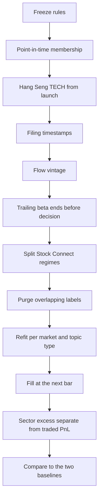

# Testing

This page is the contract for a test without look-ahead. It is not a backtest. No test has been run. No return, hit rate, or Sharpe in this repo is a result.

Freeze every rule in this file before any outcome is computed. The frozen set includes the rank key, the 5% transmission floor (plan), the 7.80 liquidity conversion (plan), the name cap (plan), the tie-break (plan), the publish-gate thresholds (assumption), the decision close (plan), and which endings count as an episode (plan). The beta-window length is unpublished and is not in the frozen set. The required-rows predicate is unlisted and is not in the frozen set. Fitting a frozen rule on the reported path is a new test. Filling in the unpublished length, or the unlisted predicate, on that path is a new test too. This spec does not contain that test.

The gate thresholds stay assumptions. Thirty episodes and half the trailing residual error are not knobs to search (assumption). The episodes the note reports are not the episodes that choose the rule.

## Sequence

Run the steps in this order. A later step does not repair an earlier leak.

### 1. Freeze rules

Write the rules down before the first label is read. The publish gate, the rank key, the floors, the decision close, which endings count as an episode, and the sleeve rules in [returns.md](returns.md) are part of that write-up. The beta-window length and the required-rows predicate are not filled in by that write-up. A change after a path is seen does not count as the same test.

### 2. Point-in-time membership

A name is in the universe on a decision date only if it was a member of Hang Seng, Hang Seng TECH, or S&P 500 that day (plan). A later addition is not eligible earlier. A deleted name stays eligible only through its membership. Use the point-in-time feed in [data.md](data.md). A current constituent file fails this step.

### 3. Hang Seng TECH from launch

Hang Seng TECH launched on 27 July 2020 (checked). The vendor base date is 31 December 2014 (checked). Do not load the back-cast from that base date as live index membership or as a live sector return. Sources are in [data.md](data.md).

### 4. Filing timestamps

Use the HKEXnews release time and the EDGAR acceptance datetime (plan). A period-end date is not a timestamp. A filing accepted after the decision is invisible. A headline about the filing is not a substitute for the timestamp.

### 5. Flow vintage

Use the buy and sell print that was public before the decision (plan). A restatement after the decision stays out. The feature is still the lagged residual (plan). Raw net buy does not enter the topic score or the sector model (plan). Northbound does not enter the Hong Kong feature set (plan).

### 6. Trailing beta ends before the decision

Any beta the model uses is a trailing window that ends before the decision (plan). The window does not include the label. The length of the window is unpublished. This spec does not set it. Choosing a length after a path is seen is a new test. Do not fill a length in on the reported path. This rule does not put rate beta into the cross-market slot. Rate beta cannot fill that slot (plan).

### 7. Split at the disclosure break

Split any Stock Connect file at 13 May 2024 and again at 19 August 2024 (checked). Real-time northbound turnover changed on the first date. The remaining northbound disclosure items changed on the second. Details and sources are in [data.md](data.md). Do not treat the two sides as one regime. Northbound is still not a Hong Kong feature on either side (plan).

### 8. Purge overlapping labels

The label horizon is 1 to 4 weeks (plan). Adjacent decisions share an outcome if their labels overlap. Drop any training row whose label window overlaps the next decision. The publish gate counts only non-overlapping resolved episodes (assumption). Thirty overlapping weeks are not 30 episodes (assumption). An episode that has not reached the end of its horizon is not resolved.

An episode is one decision in one cell, a market and a topic type, whose label window has ended and does not overlap the next decision (plan). The label is the signed expected excess the sector model wrote for that cell (plan). Several sectors on the same decision do not multiply the count. Thirty overlapping weeks are not 30 episodes, so one week of sector labels in one cell is still one episode in that cell (assumption). A second market is a second cell (plan).

The note does not erase a label. The published words `no view` are not the label. The label is the excess the sector model wrote, including when the note does not publish that excess (plan). The decision still counts when the note is published, `no view`, blocked, or failed (plan). A `no view` for a cell the model left unscored does not count (plan). An insufficient-data stop wrote no sector label and does not count (plan). A repair is the same decision, not a second episode (plan). The repair must not refit. That ban is in [execution.md](execution.md).

The run records the stop. When the topic type and the market are already known, the stop is recorded on that cell and does not increment the 30 (plan). When they are not known, the stop stands outside every cell and does not increment the 30 (plan). The stop count is not a third hurdle on the publish gate (plan).

### 9. Refit per market and topic type

Fit each market on its own (plan). Fit each topic type on its own (plan). A coefficient from US macro does not score Hong Kong flow. A pooled model fails this step. The publish gate uses the same split (assumption).

This refit is the walk-forward fit for that cell, before the label is formed (plan). It is not the repair edge in [execution.md](execution.md). The repair restates a recomputed figure and does not refit. A repair that changes coefficients, the training window, or the features is a new test.

### 10. Fill at the next bar

The decision close is the one the session calendar names in [execution.md](execution.md): the close of the daily bar in the market the label belongs to. A Hong Kong label uses the Hong Kong session close. A US label uses the US session close. Using the other market's close fails this step. A holiday does not substitute a close. The next bar is the next session of that same market. The decision may use prints known by that session (plan). The return starts at the next bar (plan). A fill on the decision bar is look-ahead. A close-to-close return that includes the decision bar fails this step. A print from the other market that was not public before this market's decision close fails this step.

### 11. Sector excess separate from traded P&L

Sector excess is the research label versus the local index (plan). Traded P&L is a different number (plan). Traded P&L would include the next-bar fill, Hong Kong stamp duty at the rate in force that day, and any sleeve rules. The default graph has no orders, so traded P&L is empty (plan). Report the two numbers in separate columns. Do not add them. Do not put them into one Sharpe.

Stamp duty rates are in [data.md](data.md). The US commission is unknown. Do not invent one.

## Baselines

Compare the frozen scorecard with two baselines (plan). Report the comparison only after the sequence above. Do not crown a winner in this document. There is no output yet.

- Shrunk-to-zero. The published excess is zero unless the publish gate opens (plan). The model is already shrunk hard toward zero (plan). A score that does not beat zero excess, after the gate and after costs, is not a result.
- Sector-momentum sign. The sign of own-sector momentum over the same horizon (plan). Own-sector momentum is already a feature (plan). A flow residual that only restates that sign has not added a signal.

If the walk-forward hit rate has not been computed, the note says there is no track record (plan). That sentence is the honest output of an unrun test.
